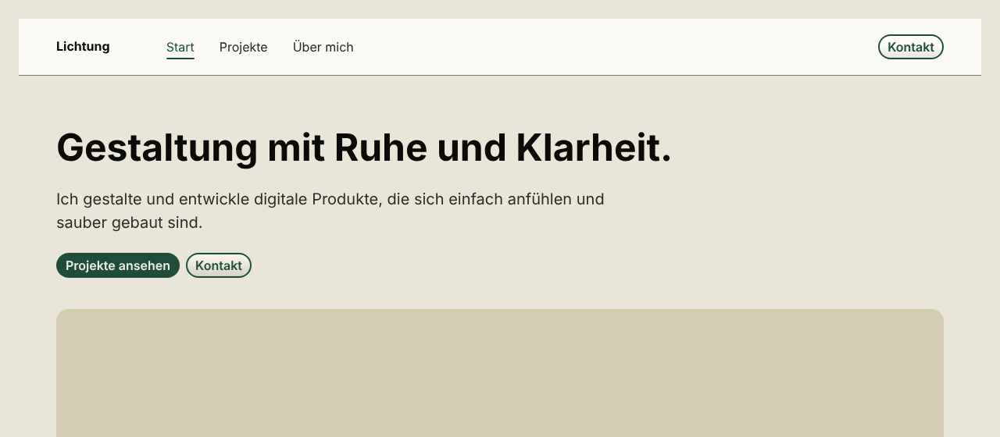
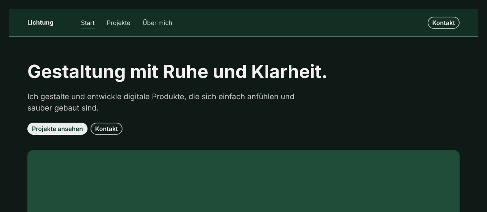
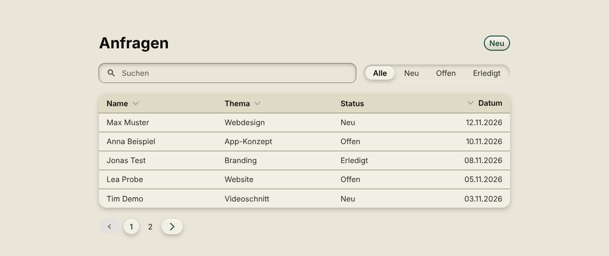
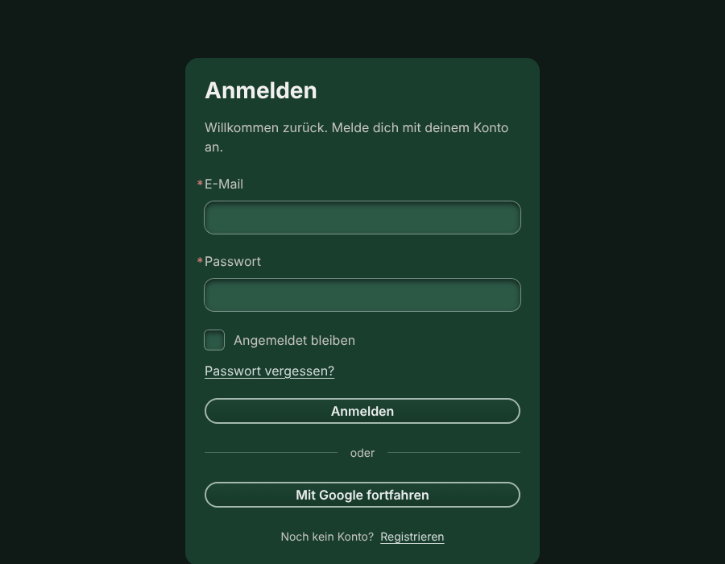

# Canopy Design System

Canopy ist ein eigenständiges, vollständiges Design System als Portfolio-Projekt von Antonia Jung: Tokens, über 50 Komponenten, Patterns, Templates und interaktive Prototypen in Light und Dark. Demo-Marke ist Lichtung, die Primärfarbe ein tiefes Waldgrün.

Entworfen in Figma, umgesetzt mit React, TypeScript und [React Aria](https://react-spectrum.adobe.com/react-aria/).

**Storybook:** https://antonia-jung.github.io/canopy-design-system/



| Landing Page (Dark) | Data Page | Login (Dark) |
| --- | --- | --- |
|  |  |  |

## Bausteine

Das System folgt Atomic Design:

- **Foundations:** Farben, Typografie, Abstände, Radien, Schatten und Motion als Tokens.
- **Komponenten:** von Button, Input und Badge bis Kalender, Tabelle, Wheel Picker und Dialog.
- **Patterns:** Login, Contact, Search, Gallery und Data Page.
- **Templates:** Landing Page, Projekt-Detail und Kontaktseite mit gemeinsamem Header und Footer, responsiv per Container Query.

## Aufbau

| Ordner | Inhalt |
| --- | --- |
| `tokens/figma-export.json` | Export der Figma-Variablen, Text- und Effektstile |
| `tokens/tokens.json` | Dieselben Tokens im W3C-Design-Tokens-Format |
| `scripts/build-tokens.mjs` | Erzeugt daraus CSS-Variablen und die Token-Liste für Storybook |
| `src/styles/` | `tokens.css` (erzeugt) und `base.css` |
| `src/motion/` | Bewegungs-Bausteine, etwa `useBlob` für wandernde Indikatoren (Feder-Simulation, Einstellungen in `blobDefaults`) |
| `src/components/` | Komponenten, je Ordner mit Komponente, CSS und Story-Gegenstück in `src/stories/` |
| `src/patterns/` | Zusammengesetzte Muster wie Login, Contact oder Data Page |
| `src/templates/` | Seitenvorlagen mit Header und Footer |
| `src/stories/` | Einführung, Foundations, Komponenten-, Pattern- und Template-Stories |

## Tokens

- Präfix `--cp-`, zum Beispiel `--cp-surface-page` oder `--cp-radius-md`.
- Theme über `data-theme="light"` oder `data-theme="dark"`. Ohne Angabe folgt Canopy der Systemeinstellung.
- Grüne Aktionsflächen setzen `data-context="on-action"`.
- Responsive Werte wechseln ab 768 px (Tablet) und 1024 px (Desktop).
- Bei `prefers-reduced-motion` oder `data-motion="reduced"` entfallen Dehnen, Bounce und Nachfedern.

Tokens neu erzeugen:

```bash
pnpm tokens
```

## Entwicklung

```bash
pnpm install
pnpm storybook       # Storybook lokal auf Port 6006
pnpm typecheck
pnpm test
pnpm build           # Bibliothek nach dist/
```

Bei jedem Push auf `main` baut GitHub Actions das Storybook und veröffentlicht es auf GitHub Pages.

## Lizenz

MIT, siehe [LICENSE](LICENSE).
